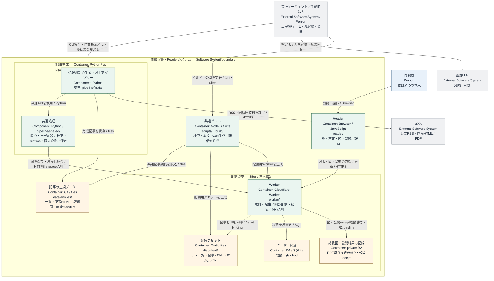

# ai-platform-feedreader

関心のある記事を収集・整理し、Readerで閲覧・管理するモノレポです。情報源ごとの記事生成、共通のPython環境と設定、Reader、認証付き配信・状態保存をまとめています。現在の収集・記事生成はarXivに対応しています。

## 全体構成



- `pipeline/shared/`：関心・モデル設定の検証、実行パスの解決、掲載図の変換・保存など、情報源に依存しない処理
- `pipeline/arxiv/`：公式RSSからの収集、分類タスク、同版の原資料取得、解説・図の検証、共通記事形式への変換
- `reader/`：記事・図・版履歴の表示、記事間の移動、既読・未読・★・badの操作
- `worker/`、`db/`、`drizzle/`：認証付き配信、画像保存、ユーザー状態のAPIとDB定義
- `scripts/`：完成記事の検証、Reader用データの生成、ビルド・公開結果の記録

生成側は [共通の記事契約](docs/data-contracts.md) に沿って `data/articles/` へ記事を保存します。Readerと配信処理は、この契約を介して生成処理から独立しています。更新時は、蓄積した記事・版履歴とユーザーの状態を保持します。

Python CLIはモデルへの入力・出力を準備、検証します。モデルの起動・結果の回収と公開操作は、必要な権限を持つ人または実行エージェントが行います。

### 情報源ごとの境界

共通の関心・モデル設定と画像保存処理は `pipeline/` に置き、収集方法、原資料の取得・検証、識別子と版の扱いは各情報源が担当します。別の情報源を追加するには、その収集・生成処理と共通記事契約へのアダプターが必要です。現在のarXiv用台帳・再開処理を、そのまま他の情報源へ適用するものではありません。

具体的なファイル構成、共通API、Readerとの接続確認は [新しいpipelineを追加する](docs/adding-pipeline.md) を参照してください。

## ディレクトリ構成

```text
ai-platform-feedreader/
├── README.md                           # 全体構成と文書への案内
├── docs/
│   ├── setup.md                        # Node・Python環境の準備と確認
│   ├── configuration.md                # 関心・モデル・並列上限の共通設定
│   ├── adding-pipeline.md              # 情報源を追加する手順と実装の参照先
│   ├── pipeline-arxiv.md               # arXivの収集設定、生成・再開の手順
│   ├── reader.md                       # Readerの表示と操作
│   ├── data-contracts.md               # 記事・画像・ユーザー状態の契約
│   └── publishing.md                   # 共通テスト・ビルド・公開手順
├── pipeline/                           # 記事生成用のPythonプロジェクト
│   ├── __init__.py                     # Pythonパッケージの入口
│   ├── pyproject.toml                  # 共通の依存関係とプロジェクト設定
│   ├── uv.lock                         # 解決済み依存バージョン
│   ├── .python-version                 # 固定Pythonバージョン
│   ├── .venv/                          # 共通Python環境（再生成可能）
│   ├── bootstrap.sh                    # 環境準備・確認の入口
│   ├── preflight.py                    # Python・ライブラリの検証
│   ├── THIRD_PARTY_NOTICES.md           # Python依存と実論文テストのライセンス
│   ├── config/
│   │   ├── interests.json              # 関心項目・採否基準・適用指針
│   │   └── agents.json                 # 工程別モデル・推論設定・並列上限
│   ├── shared/
│   │   ├── __init__.py                 # 共通処理のパッケージ
│   │   ├── runtime.py                  # JSON・ハッシュ・ロック・工程記録・パス解決
│   │   ├── collection.py               # 記事コレクションの排他・更新・途中終了からの復旧
│   │   ├── interests.py                # 関心設定の検証とプロンプトへの展開
│   │   ├── agents.py                   # モデル・推論設定と並列上限の検証
│   │   ├── image_store.py              # lossless WebP変換と保存・読戻し照合
│   │   └── tests/                      # 共通設定・環境・画像保存のテスト
│   └── arxiv/                          # arXiv固有の収集・生成処理
│       ├── __init__.py                 # arXivパッケージの入口
│       ├── workflow.py                 # 工程CLI、開始・再開・状態確認
│       ├── common.py                   # arXivの台帳・予約・完了判定
│       ├── policy.py                   # runと論文・版の処理設定を固定
│       ├── collect.py                  # 公式RSSの収集と日付・版の検証
│       ├── split_merge.py              # 分類の分割・結果検証・統合
│       ├── make_tasks.py               # 分類・解説の入出力指示を作成
│       ├── prepare.py                  # 同版HTML/PDF・書誌・出典の準備
│       ├── header_metadata.py          # 原題・著者・所属の整理
│       ├── selected_figures.py         # 選択図の検証と取得・切出し
│       ├── assemble.py                 # 出力検証・HTML図直リンク・PDF図保存
│       ├── reader_adapter.py           # 完成記事を共通記事形式へ変換
│       ├── config/sources.json         # 収集するarXivカテゴリ
│       ├── prompts/                    # arXivの分類・解説プロンプト
│       └── tests/                      # 合成フィクスチャと明示実行の実論文テスト
├── reader/                             # 共通のReader UIと独立記事表示
├── worker/                             # 認証・記事と図の配信・状態API
├── db/schema.ts                        # D1テーブル定義
├── drizzle/                            # D1変更SQLと生成履歴
├── data/
│   ├── articles/                       # 記事の正規データ
│   │   ├── papers.json                 # 一覧・版履歴・書誌・リード
│   │   ├── papers/                     # 記事HTML
│   │   ├── images-manifest.json        # 掲載図と非公開R2の対応
│   │   ├── batch-status.json           # 最新実行の公開用集計
│   │   └── batch-history/              # 日別の公開用集計
│   ├── runs/<date>/<run_id>/           # arXivの候補・台帳・出力・再開記録
│   ├── model-task-claims.json          # モデル実行予約の永続記録
│   └── releases/                       # ビルド・デプロイ別の公開結果
├── scripts/                            # 検証・ビルド・公開記録・保存対象検査
├── tests/                              # Reader・Worker・連携のテスト
├── package.json                        # Node依存関係と実行コマンド
├── package-lock.json                   # 固定Node依存バージョン
├── vite.config.ts                      # Reader・Workerのビルド設定
├── build/                              # 配信基盤のビルドアダプター
├── .env.example                        # 秘密値を含まない実行時設定の例
├── .openai/hosting.json                 # 公開先とD1・R2の接続設定
├── .gitignore                          # 一時ファイル・秘密情報の除外
├── .cache/pipeline/                    # 共通Python・uv・環境確認のキャッシュ
├── .cache/arxiv/                       # arXivのモデルタスク・実論文テストのキャッシュ
├── .sites-runtime/                     # ビルド中の作業領域
└── dist/                               # 再生成できる配信物
    ├── client/                         # UI・記事・本文表示用JSON
    └── worker/                         # ビルドしたWorker
```

`data/articles/` が記事の正規データで、`dist/` はその配信用コピーです。`data/runs/` は現在のarXiv処理用で、複数情報源の同時収集を管理する形式にはなっていません。

## 使い方と文書

1. [実行環境の準備](docs/setup.md) でNode・Python環境を用意する
2. [共通設定](docs/configuration.md) で関心・モデル・並列上限を確認する
3. [arXivの記事生成](docs/pipeline-arxiv.md) に従って収集・生成・再開を行う
4. [ビルド・公開](docs/publishing.md) に従って完成記事を検証・配信する

環境準備後、リポジトリのルートから工程CLIのヘルプを表示できます。

```sh
uv run --project pipeline --locked --no-sync python -m pipeline.arxiv.workflow --help
uv run --project pipeline --locked --no-sync python -m pipeline.arxiv.reader_adapter --help
```

画面の動作は [Readerの仕様](docs/reader.md)、生成側と配信側の入出力は [データ契約](docs/data-contracts.md) を参照してください。

## Git管理しないもの

- `pipeline/.venv/`、`.cache/`、`node_modules/`：依存環境と再生成可能なキャッシュ
- `.sites-runtime/`、`dist/`：ビルド作業領域と配信物
- `data/runs/` 内の原HTML・PDF・全文抽出テキスト、途中画像、絶対パス付きの生成タスクJSON、`site/` の中間コピー、デバッグログ
- 秘密情報や個別の認証情報

記事と再開に必要な小さな記録の保存範囲は [保存場所と責務](docs/data-contracts.md#保存場所と責務)、保存前の検査は [ソースと記録の保存](docs/publishing.md#ソースと記録の保存) に従います。

## ライセンス

本リポジトリのコードは [GNU AGPL v3.0（AGPL-3.0-only）](LICENSE) で提供します。依存ソフトウェアにはそれぞれのライセンスが適用されます。[THIRD_PARTY_NOTICES.md](THIRD_PARTY_NOTICES.md) を参照してください。
