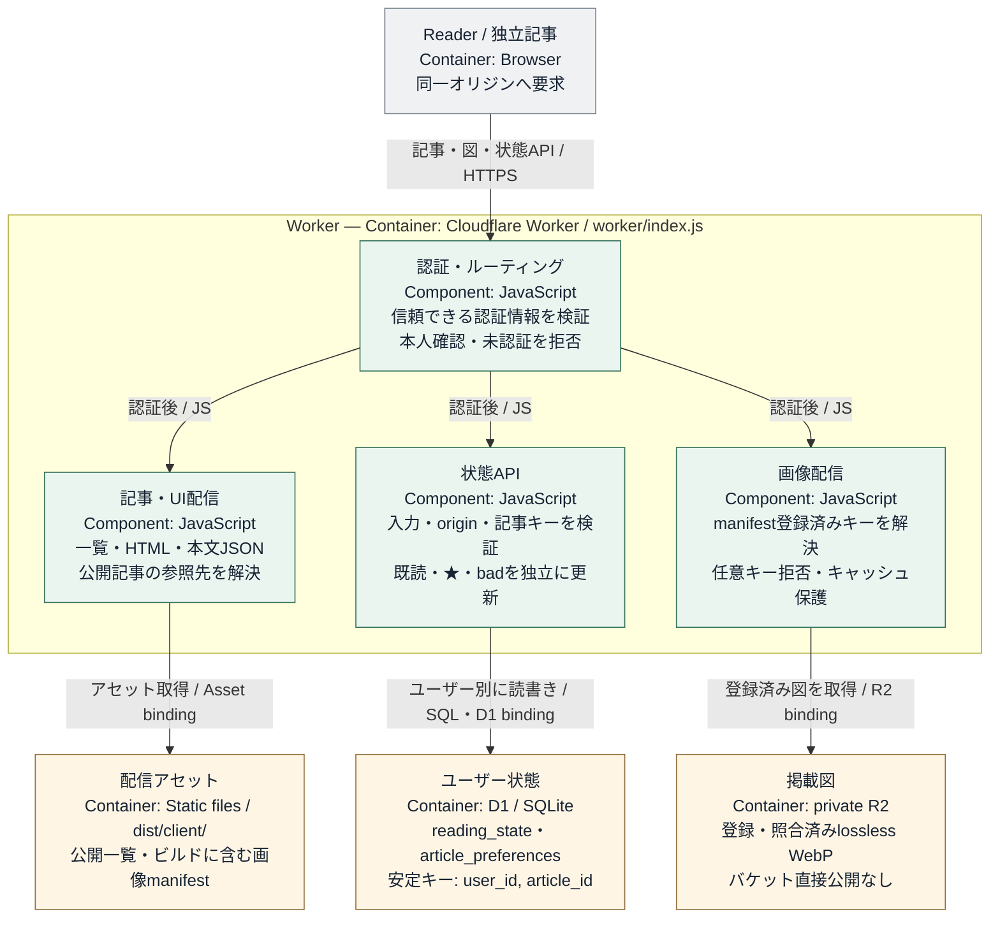

# データ契約

## 共通の記事インターフェース

生成側は、記事一覧を `data/articles/papers.json`、記事HTMLを `data/articles/papers/` に保存する。ビルドが本文表示用JSONを生成し、Readerは一覧と本文を読み込む。各情報源のアダプターが次の要素を一覧・本文形式へ対応付ける。

- 記事キー：情報源内で安定し、他の情報源と衝突しない識別子。ユーザー状態の `article_id` と一致させ、更新で変更しない
- 一覧情報：タイトル、情報源、表示日付、タグ、原文リンク、本文の参照先。情報源固有の任意フィールドは、欠落しても一覧を壊さない
- 本文：生成側で検証した記事HTMLと図参照。安全に表示し、本文中の見出し・数式・図・キャプションの対応を保つ
- 版情報：版を持つ情報源は各版の識別子、本文参照、リードと書誌を含む表示データを `versionHistory` に保持する。選択中の版の内容を使い、旧版を新版の内容で上書きしない
- 画像：arXiv HTMLの原図は各版の `linked_images` に記録した同じ版のarXiv URLを直接表示する。PDF切り抜きなど保存画像だけを `stored_images` とR2 manifestで管理する。画像のない記事は空配列を使う

記事IDにはUnicode文字、`news:123` のような名前空間、`blog/post` のようなスラッシュ区切り、名前中の連続したドットを使用できる。空文字、制御文字、バックスラッシュ、リテラル `%`、空の区切り要素と `.` / `..` だけの区切り要素、不正なUnicodeサロゲートは使用できない。ビルドとWorkerは同じ検証を行う。HTML参照は `papers/` 以下の `.html` とし、区切り要素の `.` / `..`、制御文字、バックスラッシュ、`?` / `#` を禁止する。HTMLファイル名のリテラル `%` は旧arXiv ID用の `%2F` だけに限定し、通常のUnicodeファイル名も使用できる。

arXiv記事では版なしIDを記事キーとして使う。他の情報源を追加する際は、このキーとの衝突を防ぐ名前空間などの規則をアダプターに定め、既存の記事キーを変更しない。文献検索サービスから発見した場合も、記事の原文リンク・版・書誌は原文の掲載元に対応付ける。arXivの書誌・解説は、生成処理のアダプターがこの共通形式へ変換する。

arXivの `lead_ja`、`authors`、`affiliations`、`institution_names` は、`papers.json` の記事レコードと `versionHistory` の各版へ格納する。記事レコードには最新の公開済み版の値を置き、過去版ではその版に保存した値を読む。記事HTMLとReader用の本文JSONもこの内容を使う。リードや所属を別の補助JSONへ分けず、版を切り替えても本文と一致させる。

## 保存場所と責務

記事一覧と版情報は `data/articles/papers.json`、記事本文は `data/articles/papers/` 配下のHTMLに保存し、Reader用の本文JSONを `dist/client/reader-articles/` へ生成する。Workerは公開記事一覧を参照し、D1にはユーザーの既読・評価を保存する。D1は記事本文の保管庫ではない。

Gitにはコード・文書・設定に加え、`data/articles/` の記事JSON・生成HTML・manifest・公開用集計と、`data/runs/` の再開に必要な小さなテキスト記録を保存する。実行フォルダ内の保存対象は初回処理の設定・プロンプトのsnapshot、候補・分類結果、書誌・出典メタデータ、検証済みモデル出力、工程台帳・失敗記録・公開記録とする。秘密情報は含めない。

同じ実行フォルダに置く原HTML・PDF・全文抽出テキスト・途中の図・生成タスクJSON・`site/` の中間コピーは一時ファイルで、永続保存対象に含めない。`.gitignore` と保存前の検査で除外し、読取り・図保存に不要になったら片付ける。原論文全体をGitやR2へ保存しない。依存環境とキャッシュ、`.sites-runtime/`、`dist/`、デバッグログもGit管理しない。

arXiv HTML由来の図はarXivへの直リンクとし、画像実体をSiteへ保存しない。PDF切り抜きなど保存対象のlossless WebPはSites管理の非公開R2、対応情報はmanifest、ユーザー状態はD1に保存する。公開データへは記事と公開用集計だけを渡し、`data/runs/` の詳細記録や秘密情報を含めない。

記事コンテンツは記事キーと版で対応付け、ユーザー状態は `(user_id, article_id)` で保存する。版・本文・図の更新でユーザー状態を初期化しない。

arXivの `run/processing-policy.json` はrun開始時の関心設定・収集カテゴリ・モデル設定・分類と解説のプロンプト全文をハッシュ付きで保持する。`run/paper-policies.json` は論文ID・版に入力ハッシュと初回収集時の設定を結び付ける。両ファイルは再開に必要な正規記録としてGitへ保存し、原資料や絶対パス付きタスクJSONとは区別する。設定変更の適用範囲と再開時の照合は [arXivの設定変更と再開](pipeline-arxiv.md#設定変更と再開) に従う。

### 生成runの所有権とコレクション復旧

各版の `generation_runs` は、同じ生成内容を検証・採用したrunの相対パス集合（例：`data/runs/<date>/<run_id>`）として保存する。同じSHA-256の記事を別runが採用した場合も、その参照を追加する。互換用の `generation_run` には先頭の所有runを保持し、旧レコードの単一所有情報も読み込める。一つのrunで除外・無効化しても、そのrunの参照だけを外し、他runの参照や公開記録で保護された版を残す。所有情報のない旧レコードを勝手に撤回しない。候補・分類・検証記録・選択・完成indexの欠落は空結果と見なさず、既存コレクションを変更しない。

Pythonのアダプターは `pipeline.shared.collection` の `collection_lock`、`recover_collection`、`commit_collection` を使う。ロック取得後、既存レコードを読む前に復旧する。コレクション変更は共有ロック下で、`data/articles/.collection-transaction.json` に `schema_version: 1` と各ファイルの更新意図を記録してから適用する。ジャーナルの `files` は相対パスをキーとし、JSONは `{kind: "json", data: ...}`、HTMLは `{kind: "html", data: "..."}` とする。各ファイルを原子的に置換し、すべての置換と同期が成功した後だけジャーナルを消す。途中終了後はアダプターがロック取得後に記録を再適用する。復旧待ちのジャーナルがあるコレクションをbuild・検証・公開の正常入力として扱わない。破損したジャーナルや所有者不明のロックを勝手に削除せず、復旧を確認する。

## 画像のWebP・R2保存契約（必須）

arXiv HTMLの図は例外として原図URLを直接表示する。それ以外の保存対象画像を、同じピクセル寸法を維持したlossless WebPとして非公開R2に保存する。解像度を下げず、グラフの文字・線・軸・凡例・パネルを欠かさない。HTMLのPNG・SVGなどは変換もR2保存もしない。arXivのPDF図は選んだページ範囲を216 dpiで描画したラスタ画像として扱う。losslessはラスタライズ後の画像に対する可逆圧縮であり、ベクターのままの保存とは区別する。

ラスタ入力はPNG（各標本8 bit以下）、8 bitのRGB／グレースケールJPEG、単一フレームGIF／WebPに限定する。PNGは復号後のモードだけでなく元のIHDRのbit depthを検査し、16 bitのRGB・RGBA・グレースケール＋alphaも保存前に拒否する。TIFF・BMPなど未検証の形式、CMYKなど不可逆な色変換が必要な色モデル、複数フレームは拒否し、記事を公開しない。対応形式では復号した画素と透明度を維持してWebPへ変換する。JPEG入力自体に既にある圧縮損失の復元は意味しない。SVG／PDFの明示的なラスタライズは上記の別契約に従う。

### 原資料の参照から配信URLへの変換

生成側は図の元参照を検証し、記事・版ごとに掲載図を識別する。元参照はR2への登録完了を意味しない。arXivでは `result.json.figures[].src` に `selected:fig1` のような記事内識別子を使い、本文の画像参照と1対1に照合する。モデルが原HTMLまたはPDFを読んで選んだ要素・ページ・座標は `selection` に保存する。指定形式と座標系は [arXivの記事生成](pipeline-arxiv.md#解説モデルを起動して結果を保存する) に従い、選択指定を原資料に照合してから掲載図だけを実体化する。

arXiv HTMLでは選択要素を同版原HTMLに照合し、元の画像URLを `linked_images` に記録して最終HTMLのsrcに使う。URLはHTTPSの `arxiv.org/html/<id><version>/` 配下に限定し、版違い・外部ホスト・パストラバーサルを拒否する。HTML画像はR2 manifestへ入れない。PDF切り抜きなど保存対象だけをWebP化し、アップロードと読戻し照合後に `images-manifest.json` と認証付き配信パスへ登録する。

### images-manifest.json

各掲載図と保存実体を次の形式で対応付ける。

    schema_version: 1
    images: [
      {
        article_id: string,       # 更新で変わらない記事キー
        version: string,          # 生成元の版識別子
        source_ref: string,       # 生成側の掲載図参照と完全一致
        object_key: string,       # R2内の一意キー
        serving_path: string,     # 同一オリジンの認証付き配信パス
        mime_type: "image/webp",
        sha256: string,           # 保存するWebPバイト列のSHA-256、64桁小文字hex
        width: integer,           # 保存画像の幅、正整数
        height: integer,          # 保存画像の高さ、正整数
        byte_size: integer        # 保存画像のサイズ、正整数
      }
    ]

上記は掲載画像ごとの必須フィールド。`(article_id, version, source_ref)` は一意とする。同一のWebPバイト列を複数記事で再利用してもよいが、各記事・版からの対応を保持する。共通の保存入口は `papers/<URLエンコードしたid>/<version>/<sha256>.webp`（原SVGは `.svg`）を使う。IDはPythonの `quote(id, safe="")` と同じ正規形で一度だけエンコードする。Unicode・名前空間・ID内の `/`・`a..b`・`~` に対応する。versionは英数字で始まる1〜64文字の英数字・`.`・`_`・`-` に限定し、`v1`、`current`、`revision-a` を同じ規則で扱う。絶対パス、空セグメント、単独の `.`／`..`、制御文字、バックスラッシュ、不正なpercent encoding、二重encoding、version内の区切り文字は拒否する。保存入口とmanifestは共通のオブジェクトキー検証を使う。

運用上追加してよいフィールドは `source_sha256: string`、`original_mime_type: string`、`original_byte_size: integer`、`original_object_key: string`、`rasterization: object`、`uploaded_at: ISO8601`、`verified_at: ISO8601`、`etag: string`。ETagをSHA-256と同一視しない。ベクター素材をラスタライズする場合は、`rasterization` に使用寸法・変換条件を記録し、非公開R2に保持する元素材のキーを `original_object_key` に保存する。原論文全体の保管には使わない。

`stored_images` は最終記事の版レコードに保持する、該当するmanifestレコードの配列。各版で必須とし、図がなければ `[]`。保存した掲載図と `stored_images` は1対1対応し、本文・図キャプション・原資料参照・R2キーを追跡できること。画像対応情報の更新だけを理由に、解説本文やリードを書き直さない。

### HTMLの原図直リンク

`linked_images` は各版に保存する配列で、未指定は空配列として扱う。各要素は `source_ref`、同版の原図 `url`、HTMLの `selection`、原HTMLの `source_document_sha256` を持つ。本文画像は `stored_images` と `linked_images` のいずれかに1対1対応する。Readerと単体記事の両方で直リンクを保持し、外部画像には `referrerpolicy="no-referrer"` を使う。表示時の画像取得は読者のブラウザーからarXivへ直接行う。

### 認証と保存

R2バケットを一般公開しない。Workerが信頼できる認証情報を検証してから登録済みのオブジェクトを取得する。本人限定アクセスを維持し、未認証・対象外の利用者、未登録キー、パストラバーサルを拒否する。リクエストで自己申告されたuser_idを信用せず、認証情報を公開manifestへ入れない。認証後のレスポンスも共有キャッシュから別利用者へ漏れないようにする。

画像保存工程では、R2のbindingまたは保存用APIからアップロード済みの実体を読み、存在・MIME・SHA-256・寸法を確認する。保存画像の取得はmanifestに登録した認証付き配信パスに限定し、利用者から任意のR2キーを受け取らない。配信経路の認証とパス解決は、公開予定のWorkerとmanifestを使う公開前テストで確認する。画像の保存・照合や配信テストに失敗した記事は公開せず、公開済みの正常な記事を保持する。

## D1のテーブル

D1には `reading_state` と `article_preferences` の2テーブルを置く。定義は `db/schema.ts`、DB変更履歴は `drizzle/`、読み書きは `worker/index.js` が担当する。TEXTの日時はWorkerが `new Date().toISOString()` で書くISO 8601文字列。DB上の日時専用型ではない。

### reading_state

    user_id     TEXT NOT NULL
    article_id  TEXT NOT NULL
    read_at     TEXT NOT NULL
    PRIMARY KEY (user_id, article_id)

認証されたユーザーと安定した記事キーの組に、最後に既読として保存した時刻を持つ。既読にするとUPSERTし、未読に戻すとその行をDELETEする。行の不在が未読を表す。`GET /api/reading-state` は当該ユーザーのarticle_idを返し、他のユーザーの状態を混ぜない。新版追加時に別のarticle_idを作らない。

### article_preferences

    user_id                TEXT NOT NULL
    article_id             TEXT NOT NULL
    starred                INTEGER NOT NULL DEFAULT false
    bad                    INTEGER NOT NULL DEFAULT false
    starred_updated_at     TEXT NULL
    bad_updated_at         TEXT NULL
    bad_reason             TEXT NULL
    bad_source             TEXT NULL
    bad_source_message_id  TEXT NULL
    PRIMARY KEY (user_id, article_id)

`starred` と `bad` はDrizzleのboolean modeで扱うINTEGER。Workerの書込みは0/1を使う。★とbadは独立して更新し、一方の更新で他方を上書きしない。falseへ変更しても行とその項目の更新時刻を保持する。

`bad_reason` は評価理由、`bad_source` は評価の由来、`bad_source_message_id` は元メッセージの参照。画面操作でbadを解除したときは理由をnullとし、由来に操作種別を保存し、元メッセージ参照はnullにする。

`GET /api/article-preferences` はstarredIdsとbadIdsを返す。行がなくても両フラグをfalseとして扱える。badを収集・分類・記事削除の条件へ転用しない。

### D1 APIの境界

Site上のWorkerは `oai-authenticated-user-id` でユーザーを解決し、未認証は401、DB利用不可や保存失敗は503を返す。POSTは同一origin、JSON、サイズ、存在する記事キー、許可された操作を検証する。ユーザー別キーに基づいて状態を読み書きする。記事公開や画像登録からD1の既読・評価を初期化しない。R2画像配信も同じ本人限定アクセス境界で所有者を確認する。

### Workerの内部構成

D1 APIと画像配信に共通する認証境界、および保存先へのアクセス。

## Workerの具体的なAPI契約

- `GET /api/reading-state`：`{ "readIds": ["stable-article-key"] }`
- `POST /api/reading-state`：`{ "articleId": "stable-article-key", "operation": "read" }`。操作は `read` または `unread`
- `GET /api/article-preferences`：`{ "starredIds": [], "badIds": [] }`
- `POST /api/article-preferences`：`{ "articleId": "stable-article-key", "operation": "star" }`。操作は `star`、`unstar`、`bad`、`unbad`

POSTは同一Origin、`application/json`、4096バイト以下、公開一覧に存在する記事キー、上記2フィールドだけを受け付ける。成功は `{ "ok": true }`。`unbad` は理由と元メッセージ参照をnullにし、由来を `reader:unbad` とする。

本人設定や信頼する認証入口の設定不足は503、認証IDがない場合は401、本人以外は403、DB失敗は503とする。query・本文・任意のAuthorization値に含むuser_idは使用しない。全応答は `Cache-Control: private, no-store` とし、Cookie・Authorization・認証ヘッダーでVaryする。

`GET/HEAD /api/images/<sha256>` はmanifest登録済みの図だけを取得する。query、encoded traversal、未登録パス、不正なキー、重複識別子、矛盾するメタデータは拒否する。WorkerはR2のMIME・バイト数・SHA-256・lossless WebPの寸法を照合し、生成側は追加で完全decodeとupload/readbackを検証する。元ベクター素材は非公開保存し、この経路では配信しない。この画像配信経路は読取り専用であり、アップロードには使わない。

必要時だけ有効にする `GET/PUT /api/storage?key=...` は、生成工程向けの保存・読戻し経路である。manifest登録前の限定形式のオブジェクトキーを扱う。Sitesの本人限定設定と信頼できる入口を確認し、`SITES_STORAGE_ENABLED=true` の場合に限り利用できる。同一originの本人ブラウザーからのPUTも許可し、本人ID、専用ヘッダー `X-Reader-Upload: 1`、MIME、最大32 MiB、キー内のSHA-256とバイト列の一致を検証する。cross-origin要求を拒否し、CORSは許可しない。

サービス用トークンはSitesの入口が検証・消費し、Workerには訪問者IDを渡さないため、この保存経路の認証は本人限定のSites入口に依存する。Worker単独で匿名要求を認証できるわけではなく、直接公開や別プロキシによる迂回を許可しない。Siteの公開範囲を変更する前に保存経路を無効化する。保存APIのMIME・ハッシュ検証は完全な画像decode検証とは別であり、生成側の画素検証とmanifest登録を経て初めて読者向け画像配信に使う。詳細は [公開手順](publishing.md#pythonからsites管理r2へ保存する) を参照する。

## 公開結果と配信中の状態

`data/releases/<build_id>.json` は最新の公開全体の記録、`data/releases/<build_id>-<deployment_idのSHA-256>.json` はデプロイ試行ごとの記録とする。`site_id`、`build_id`、`deployment_id`、`status`、`collection_sha256`、`artifact_sha256`、記事・版・本文ハッシュの `articles` を保存する。成功時は確認URL・日時、テスト・ビルド成功の証拠も必要。対象runがなくても省略せず、後の失敗で以前の成功した試行記録を消さない。秘密情報を含めずGitで保持する。

ビルドには `release-identity.json` を含め、Site・build・collectionのハッシュを固定する。循環ハッシュを避けるためidentity自身はartifactハッシュの対象外とするが、公開snapshot検証で値の一致を必ず確認する。凍結した `batch-status.json` はビルド時点の記録であり、公開成功を先取りして書き込まない。

成功確認後の公開receiptは既存の非公開R2の `release-status/<build_id>.json` に保存する。`/api/deployment-status` の保存・読戻しは図保存と同じ確認済み本人限定Sites境界を要求する。receiptはSite・build・collectionと、配信された記事・版・本文ハッシュの集合に一致しなければ受け付けない。同じデプロイIDの再試行は同一内容のみ許可する。同じbuildの別デプロイへの更新は同一の記事・集計とより新しい確認日時を必要とし、古い結果で上書きしない。公開バッチの `completed_articles` は正規記事と照合済みのID・版・本文ハッシュで、公開件数もこの完全一致で数える。

読者用 `/batch-status.json` は本人認証後、現在のbuildに対応するreceiptの集計を返す。receiptがない、または読めない間は `verification_pending` とし、記事自体は読める状態を維持する。成功した公開はreceiptの読戻し確認まで完了扱いにせず、手順は [公開手順](publishing.md#公開対象の固定と結果記録) に従う。
