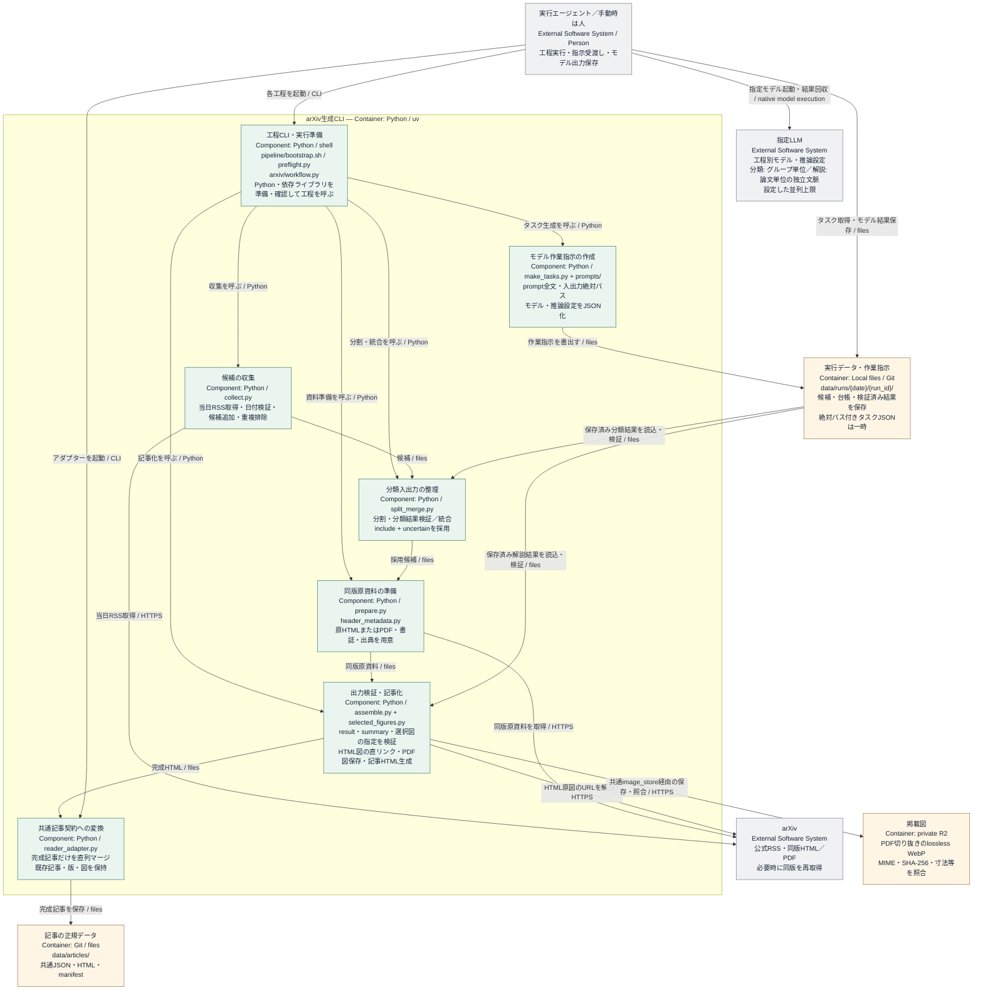

# arXivの記事生成

公式RSSから論文を集め、関心に合う論文の全文と図を読んで日本語記事を作る。処理は収集、分類、原資料の準備、解説、記事化の順に進む。

## 対象と更新方針

分類はタイトルとabstractを使い、[共通の関心設定](configuration.md#関心分野)に指定した関心領域に基づいて行う。includeとuncertainを採用し、入力不備や分類失敗を除外扱いにしない。bad評価で分類規則や保存済み論文の採否を変更しない。

記事には、研究の問い・方法・結果を伝える3行リードを付ける。書誌・リード・本文の書き方は解説プロンプトに定める。通常更新では既存記事を保持し、新しい論文や版を追加する。

毎回、実行開始時のAsia/Tokyoの日付を当日として固定し、当日分のRSSを取得して候補を保存する。その後、当日分の記事生成と、開始時点の保存済み台帳にある過去の未完了実行の再開を行う。過去分の再開で当日の収集を置き換えず、日付をまたいでも今回の当日を変更しない。

### 収集するカテゴリを設定する

[`pipeline/arxiv/config/sources.json`](../pipeline/arxiv/config/sources.json) の `categories` に、収集するarXivカテゴリを指定する。

```json
{
  "schema_version": 1,
  "categories": ["cond-mat.mtrl-sci", "physics.chem-ph", "physics.comp-ph", "cs.AI", "cs.LG", "cs.CL"]
}
```

`schema_version` は整数の `1`、`categories` は重複のない1項目以上の文字列配列にする。URLではなくarXivのカテゴリ識別子を指定する。公式RSSのURLはコードが組み立てる。設定の欠損・形式不正はエラーになり、別のカテゴリへフォールバックしない。取得失敗は収集失敗として記録する。

### 設定変更と再開

関心設定・収集カテゴリ・モデル設定・分類と解説のプロンプトは、run開始時に `run/processing-policy.json` へハッシュ付きで保存する。カテゴリの変更は新しいrunから適用し、同じrunの収集再試行では保存されたカテゴリを使う。

論文のID・版ごとに、最初の収集時の設定・プロンプトを指すハッシュと入力ハッシュだけを `run/paper-policies.json` へ保持する。設定本体はrun共通の `run/processing-policy.json` に1回、別runから引き継いだ異なる設定は `run/policies/<sha256>.json` に設定ごとに1回保存する。同じ論文・版が別runにも現れた場合や、過去の未完了処理を再開する場合は、元の設定・プロンプトを使う。設定変更を理由に過去の採否を変えたり、既存記事を再生成したりしない。新しい関心・モデル・プロンプト設定は新しいrunで初めて取り込む論文・版に適用する。分類のグループ分割にはrun開始時の並列上限を使う。新しいモデル実行予約は [現在の共通上限](configuration.md#モデルと並列数) に従う。

再開に必要な過去の設定がない、ハッシュが一致しない、または履歴に矛盾がある場合は、影響する処理を止める。現在の設定で過去の処理を置き換えない。保存済みの元の設定を復旧してから再開する。

### arXiv生成の内部構成

収集から記事の組立てまでの工程と、外部モデルへの受け渡し。



全工程は同じ実行フォルダと台帳を使う。prepareは原資料と書誌・出典情報を用意し、解説モデルが原資料を読んで掲載図を選ぶ。selected_figures.pyはassembleで選択指定を検証し、選ばれた画像やPDF領域だけを取得・切り出す。

## 1. 実行環境を準備する

対象のリポジトリから保存済みの記事と実行記録を取得する。入力の読取り、指定モデルの起動・結果回収、ファイル保存、非公開R2への画像保存に必要な機能と権限を確認する。秘密情報は実行環境の秘密情報設定へ置く。

arXiv更新の開始時刻を環境準備より前に固定する。

```sh
cd /path/to/ai-platform-feedreader
export PROJECT_ROOT="$PWD"
export STARTED_AT="$(TZ=Asia/Tokyo date +%Y-%m-%dT%H:%M:%S%z)"
export TODAY="${STARTED_AT%%T*}"
```

続けて同じシェルで [実行環境の準備](setup.md) に従い、依存関係の準備とbootstrapを実行する。関心・モデル設定は [共通設定](configuration.md)、収集カテゴリは本書の [収集するカテゴリを設定する](#収集するカテゴリを設定する) を確認する。

## 2. 記事を生成する

bootstrap後にリポジトリのルートから次の入口を実行する。`STARTED_AT` は準備前の開始時刻を保ち、日付をまたいでも当日は `TODAY` のままにする。

```sh
uv run --project "$PROJECT_ROOT/pipeline" --locked --no-sync python -m pipeline.arxiv.workflow start --project-root "$PROJECT_ROOT" --started-at "$STARTED_AT"
```

`start` は当日runを選択または作成し、開始時点の保存済み台帳から過去の未完了一覧を固定する。当日RSSの取得を先に試み、成功・失敗を記録してから、当日のパス `today` と過去分の `backlog` をJSONで返す。モデル実行や過去分の処理は自動では行わない。

返された `today` を `RUN_DIR` に設定する。`RUN_ID` はその末尾の識別子を使う。以下のプレースホルダーを実際の出力に置き換える。

```sh
export RUN_DIR="<startが返したtodayの絶対パス>"
export RUN_ID="${RUN_DIR##*/}"
export TARGET_DATE="$TODAY"
cp "$PROJECT_ROOT/.cache/pipeline/preflight.json" "$RUN_DIR/preflight.json"
cd "$RUN_DIR"
```

当日分を先に進め、その後 `backlog` の各実行へ移る。過去分では元の対象日・run_idに合わせて `TARGET_DATE` と `RUN_DIR` を切り替え、各実行のbootstrapレポートを更新し、保存済み候補から未完了工程を再開する。完成記事は `data/articles/` へ保存する。

### 候補を集めて分類タスクを作る

当日分の公式RSSからID・版・title・abstractを収集する。候補の永続一覧にはID・版・日付・原論文URL・入力ハッシュだけを保存し、title・abstractは分類用の一時キャッシュに保持する。取得日時・収集範囲・日付の検証結果も残す。RSSは更新されるため、過去分の再開や分類・解説より先に取得・保存する。同日実行の保存済み候補へ追加・重複排除し、空のRSSで既存候補や処理済み状態を消さない。取得失敗・日付不一致・不正な入力は「新着なし」と区別して記録する。

新規のネットワーク取得では毎回 `https://rss.arxiv.org/rss/<category>?_fetch=<time.time_ns()>` を使い、配信キャッシュで古いRSSを返されることを避ける。取得したXMLと取得URL・時刻・ハッシュはrun内の `.cache/feeds/<date>/<category>.xml` と `.metadata.json` に保存し、同じrunの通常の再開では保存済みRSSを再利用する。キャッシュも対象日・カテゴリ・内容を照合する。これらの一時ファイルはGit管理しない。

`start` が当日収集を試みた後は `split` へ進む。保存済みRSSを使わず当日分を取り直す場合は `start` または `collect` に `--refresh-rss` を付ける。下の `collect` は同じ `STARTED_AT` で実行する。取得・XML・日付の検証に失敗した応答はキャッシュへ保存せず、以前の正常なRSSと候補を残して再取得の失敗を報告する。過去分では保存済み候補を使い、現在のRSSで過去の収集結果を作り直さない。未分類候補の一時入力が失われても保存済みRSSが残っていれば、`--refresh-rss` を付けない `collect` で復元できる。RSSも失われた場合は元のtitle・abstractを入力ハッシュに照合して復元するまで分類を止める。分類済み候補の採否・状態確認・記事化には一時入力は不要。有効な未分類候補を、保存された処理設定と並列上限に従ってグループに分ける。候補が0件の場合は分類モデルを起動しない。当日分・過去分の分類と解説を合わせた同時起動数を制限する。

    # 保存済みRSSも使わず、当日収集をやり直す場合
    uv run --project "$PROJECT_ROOT/pipeline" --locked --no-sync python "$PROJECT_ROOT/pipeline/arxiv/workflow.py" collect --date "$TARGET_DATE" --timezone Asia/Tokyo --started-at "$STARTED_AT" --refresh-rss

分類タスクは各実行フォルダで作る。以下の工程では実行フォルダを作業ディレクトリにするため、CLIの絶対パスを指定する。リポジトリのルートでは `python -m pipeline.arxiv.workflow`、`python -m pipeline.arxiv.reader_adapter` でも起動できる。

    uv run --project "$PROJECT_ROOT/pipeline" --locked --no-sync python "$PROJECT_ROOT/pipeline/arxiv/workflow.py" split
    uv run --project "$PROJECT_ROOT/pipeline" --locked --no-sync python "$PROJECT_ROOT/pipeline/arxiv/workflow.py" classify_tasks

### 分類モデルを起動して結果を保存する

`run/classifier_tasks.json` の各タスクには `task_name`、`model`、`reasoning_effort`、`independent_context`、`prompt`、`input_files`、`output_files` を入れる。`prompt` には変数を展開した分類プロンプト全文、入力には読み取れるファイルを、出力には書き込める保存先を、それぞれ絶対パスで指定する。

1.  タスクのモデル設定に従い、promptと入力ファイルを渡して起動する。入力を直接読めない場合は添付する。分類グループ間・解説する論文間の文脈を独立させる。設定したモデル・推論設定が実行環境で利用できるか確認し、未対応の場合は勝手に別モデルへ置き換えず該当処理を止める。実行環境の同時実行制限も守る
2.  終了を待って応答を回収し、`output_files` の指定先へ保存する。モデルがファイルを書けない場合は、実行担当が応答をそのパスへ保存する
3.  出力の存在・形式・IDと版の対応を検証し、成功・失敗を記録する。成功した分類結果を統合し、失敗したグループは未判定として残す

起動の直前に各タスクのclaimを取得し、返された `claim_token` を保存する。以下は分類タスクの先頭を処理する例で、`--task-index` は対象の配列位置、`--owner` は実行担当の識別子とする。

```sh
PY="$PROJECT_ROOT/pipeline/.venv/bin/python"
CLI="$PROJECT_ROOT/pipeline/arxiv/workflow.py"
"$PY" "$CLI" claim --task-file run/classifier_tasks.json --task-index 0 --owner executor-name
# 指定モデルで処理し、output_filesへ出力を保存してから実行する
"$PY" "$CLI" finish --task-file run/classifier_tasks.json --task-index 0 --token "$CLAIM_TOKEN"
```

`CLAIM_TOKEN` には取得した値を設定する。`finish` が構造・ID・版・出力を検証してreceiptを保存し、枠を解放する。実行や検証に失敗した場合は原因を台帳へ記録し、モデルの停止を確認してから同じ引数で `finish` の代わりに `release` を実行する。解説も `run/summary_tasks.json` を指定して同じ操作を行う。

途中経過の報告を完了とみなさず、モデル実行が実際に終了し、出力ファイルへの書込みが止まってから `finish` を実行する。receipt作成後に出力が変更された場合、そのreceiptでは記事化できないため、出力とタスクを確認して正式に再検証する。

claimは当日・過去分を通じた同時起動数と、同一入力・プロンプトの重複起動を制限する。自動失効しないため、停止した処理を確認してから解放する。別マシンでも同じ共有チェックアウトとregistryを使い、独立コピーから同時起動しない。入力・保存済みプロンプト・モデル設定・出力バイト・原資料ハッシュを検証して再利用する。現在の設定ファイルの変更だけで過去の結果を無効化しない。`run/task-receipts/` はキャッシュ再構築に必要な保存記録とする。

タスクJSONを作るだけではモデルは起動しない。必要な資料を読めない、指定モデルを使えない、結果を保存できない場合は、該当工程を止めて原因を記録する。

### 分類結果をまとめて解説資料を準備する

成功した分類結果からincludeとuncertainを採用する。同じ版の全文HTMLを優先し、利用できなければ同版PDFを使い、原資料と書誌・出典情報を用意する。prepareは画像を取得・抽出しない。原HTMLまたはPDFと必要な全文補助テキストは処理中だけ使う。

HTMLの論文本体のfigureに欠落した画像がある場合、新規準備では同じ版のPDFを試す。既に検証済みHTMLを保存した未公開論文は、自動で資料形式を変更しない。元HTMLと欠落図を確認し、対象runのモデル処理が停止していることを確認してから、次の明示的な再準備を行う。

    "$PY" "$CLI" prepare_pdf --paper-id 2610.12345 --paper-version v1

IDと版は対象論文に置き換える。この操作は選択済み・未公開の論文に限り、元HTMLの同一性と欠落図、稼働中claim、既存のモデル出力を確認する。未検証の `result.json`・`summary.md` がある場合は、内容を確認して安全に退避した後に再実行する。元の出典記録は `source-history.json` に残す。変更後は `summary_tasks` を作り直し、同じ版のPDFを入力として解説と図の選択をやり直す。公開済み・公開確認中の版や検証済みモデル出力がある場合は自動で差し替えず、確認まで止める。

    uv run --project "$PROJECT_ROOT/pipeline" --locked --no-sync python "$PROJECT_ROOT/pipeline/arxiv/workflow.py" merge
    uv run --project "$PROJECT_ROOT/pipeline" --locked --no-sync python "$PROJECT_ROOT/pipeline/arxiv/workflow.py" prepare
    uv run --project "$PROJECT_ROOT/pipeline" --locked --no-sync python "$PROJECT_ROOT/pipeline/arxiv/workflow.py" summary_tasks

### 解説モデルを起動して結果を保存する

`run/summary_tasks.json` の各タスクに、解説プロンプト全文と、その論文・版の書誌・出典情報、原HTMLまたはPDFのファイルを指定する。全文補助テキストがあっても原資料の代わりにはせず、原資料そのものを必ず入力へ含める。分類と同じ手順でモデルを起動・回収し、指定先へ `metadata.json`、`result.json`、`summary.md` を保存する。一時原資料が残っていない場合は、同版資料を再取得して有効な入力パスへ更新する。

原資料の版付きURL・形式・ハッシュの確認は準備・検証コードに任せ、通常時に実行担当がPDF冒頭の版表記を別途確認しない。論文本文・記事本文と図の内容の確認は解説を作成するモデルが担当し、実行担当や別のレビュー担当が正常な出力を読み直して重複確認する必要はない。実行担当は終了・失敗・receiptと組立て結果を確認し、通常は候補一覧や論文本文、生成記事を全文表示しない。エラーや不一致がある場合だけ、原因の特定に必要な範囲を確認する。

解説モデルは原資料の全文と図を直接読み、記事に掲載する図だけを選ぶ。本文の画像参照と `result.json.figures[].src` は `selected:fig1` のような一意の識別子で対応付ける。各図には `number`、日本語の `caption`、`source.json.url` と一致する `source`、次の `selection` を保存する。

- HTML: `{"kind":"html","element_id":"S2.F1","asset_index":0}`。元HTMLの論文本体内で一意のidを指定し、その要素自身がimg・svg・objectならindex 0、そうでなければ子孫のimg・svg・objectを文書順で0始まりに数える。指定要素の画像は同じfigureに属するものに限る
- PDF: `{"kind":"pdf","page":2,"bbox":[54,120,558,410],"units":"pt","page_bounds":[0,0,612,792]}`。ページは1始まり、座標は表示ページ左上原点のポイント単位とし、実際のページ境界と照合する。切り出し範囲には軸・凡例・必要なパネルを含める

上記は形式の例で、要素ID・ページ・座標は原資料で確かめた値を使う。モデルは原資料に基づいて図番号・キャプションと選択位置を照合し、確認できない図を推測で指定しない。

### 記事を組み立てて保存する

PDF切り抜きを含む記事では、[Sites管理R2への保存設定](publishing.md#pythonからsites管理r2へ保存する) に従い、`READER_SITE_URL`（HTTPSのSite origin）と `SITES_SERVICE_TOKEN` を実行プロセスの環境に渡す。初回のSite設定と保存経路の有効化は同文書に従う。画像保存はSites経由のみとし、接続設定がなければ失敗する。秘密値はGit・ログ・記事・プロンプトへ保存しない。バケットの非公開設定と認証付き配信経路を確認する。HTML画像だけの記事や図がない記事にはR2アップロード接続を要求しない。ラスタ画像の透過情報は保持する。元ファイルの形式・bit深度・色モデルを変換前に検査する。[画像契約](data-contracts.md#画像のwebpr2保存契約必須)で対応していない入力や複数フレーム画像は、情報を捨てて変換せず、アップロード前にその記事の画像工程を失敗として記録する。

`assemble` がモデル出力と選択指定を原資料に照合する。HTML図は選択した元要素から同じ版のarXiv画像URLを解決し、`linked_images` と本文のsrcへ記録する。HTML画像の実体は取得・変換・R2保存しない。PDF図だけを指定ページの選択範囲から216 dpiで描画し、lossless WebPとしてR2へ保存・読戻し照合する。保存画像だけを `stored_images` とmanifestに登録して記事HTMLを組み立てる。アダプターは完成記事だけを保存先へ反映する。

    uv run --project "$PROJECT_ROOT/pipeline" --locked --no-sync python "$PROJECT_ROOT/pipeline/arxiv/workflow.py" assemble
    uv run --project "$PROJECT_ROOT/pipeline" --locked --no-sync python "$PROJECT_ROOT/pipeline/arxiv/reader_adapter.py" --site site --run run --articles-dir "$PROJECT_ROOT/data/articles"
    cd "$PROJECT_ROOT"

アダプターは、現在の候補・分類結果・モデル出力の検証記録と一致する完成記事をコレクションへ反映する。未公開の記事は同じ論文版でも再生成した内容に更新できる。その処理に保存された設定で分類から除外された、または入力・検証記録が一致しない未公開記事については、そのrunの所有参照を外す。同一生成内容を別runも検証・採用済みの場合は、そのrunの参照を保持する。必要な記録が欠けている場合は除外や空結果と見なさず、コレクション変更を止める。公開済み、または公開結果の確認中の版は上書きしない。同じコレクションへの反映は直列化し、個別の失敗を記録する。保存対象の記事と実行記録をGitへコミットし、リモートへ反映する。未完了の対象は同じ実行の記録から再開する。

### 保存済みHTML図を直リンクへ移行する

利用者が既存記事の配信方式変更を明示した場合は、次の移行コマンドで同版原HTMLのハッシュと選択図を照合して画像srcだけを変更する。本文・リード・図の選択・キャプション・既読と評価は変更しない。公開済みの元のrelease記録は保持し、変更後は改めてビルド・公開して新しいハッシュを記録する。旧R2オブジェクトは削除せず、現行manifestからHTML図の登録を外す。

```sh
python -m pipeline.arxiv.link_html_images --project-root /path/to/project --run /path/to/project/data/runs/DATE/RUN_ID --cache /path/to/project/.cache/direct-image-migration
```

## 失敗・部分公開・再開

収集・分類結果統合・原資料準備・タスク生成・記事組立てで対象の一部が失敗すると、CLIは `status: "partial_failure"`、成功分の `result`、失敗対象の `failures` を出力し、終了コード1を返す。これは全件成功ではないが、検証済み成功分は保存されている。出力と台帳を確認して成功分だけ後続へ進め、失敗対象を未完了として残す。前提ファイルの欠落は、保存済みの空配列とは区別してエラーにする。

分類はグループ単位、原資料の準備・解説・画像保存は論文と版の単位で成否を記録する。失敗した対象を残して成功分を進め、完成記事だけを部分公開できる。未完成の記事は一覧に追加せず、失敗した新版で公開済みの版を置き換えない。

記事単位の整合性に失敗した出力は採用しない。公開済みの記事・版履歴・図とユーザーの既読・★・badは保持する。対象が0件でも無関係な記事は削除しない。コレクション更新が途中で終了した場合は、アダプターを再実行して保存済みの更新内容を復旧する。復旧が終わるまでビルドを拒否する。

再開時は元の対象日・run_idと保存済み候補・台帳を使い、失敗・未完了の工程から進める。記事キー・版と入力・その論文に保存されたプロンプトのハッシュを照合し、検証済みの分類結果・モデル出力・記事を実行間でも再利用する。同じ対象の処理中状態も確認し、同じモデル処理を重複して起動しない。必要な原資料は記録した同版URLから再取得して版とハッシュを照合する。一時ファイルと絶対パス付きのタスクJSONは現在の環境で作り直す。現在のプロンプトや関心設定を過去の処理へ遡及させない。同一版の入力矛盾や保存記録の破損は、原因を確認・復旧するまで該当処理を止める。

過去分の候補記録が利用できない場合は、対象日・run_idと再開不能の理由を記録する。現在のRSSを過去分として扱ったり、取得できていない履歴を取得済みと報告したりしない。一つの実行や記事の失敗で他の実行を止めず、当日分も進める。当日RSSの取得に失敗しても、利用できる保存済み候補の処理は続ける。直近の取得試行は `collect_attempt`、保存済みの検証済み収集範囲は `collect` と `run/collection-capture.json` に分けて記録する。必要な各feedを同じ対象日について検証済みで、候補ハッシュも一致する場合は、後続の通信失敗で既存の収集完了を取り消さない。失敗した取得試行自体は失敗として報告する。初回取得失敗・不足feed・同一版の入力矛盾は完了扱いにせず、collectの残件を表示する。共通基盤の不備は実際に依存する工程だけを止め、収集・保存できる範囲は先に確保する。

今回の処理対象は当日分と、開始時点の保存済み台帳にある過去の未完了実行とする。残件は元の実行記録へ保存し、次の通常更新で再開する。同じ実行への書込み、共有記事への追加、同じ公開先へのビルド・公開はそれぞれ直列化し、未完了分の完了を待たず検証済み完成記事を部分公開できる。

## 実行記録

`data/runs/<date>/<run_id>/` を実行の作業場所にする。dateはJSTの対象日、run_idは実行を識別するIDとする。以下の区分で管理する。再開に必要な小さなテキスト記録をGitに保存し、同じ場所に作る原資料・画像・中間コピーは一時ファイルとして除外する。

- `preflight.json`：毎回のbootstrapによる準備・環境確認の結果
- `ledger.json` と `failures.jsonl`：元の対象日・run_id、収集日時・範囲、工程の成否、残件と失敗原因。他の実行の成果物を再利用した場合はその参照を残す
- `release.json`：公開する記事と版、テスト・ビルド結果、公開先・識別子とデプロイ結果
- `run/processing-policy.json`：runの収集カテゴリ・関心設定・モデル設定・分類と解説のプロンプト全文、および整合性検証用ハッシュ
- `run/paper-policies.json`：論文ID・版ごとの `input_sha256` と `policy_sha256` のみ。関心・モデル・プロンプト本体は埋め込まない
- `run/policies/<sha256>.json`：他runから引き継いだ設定をハッシュごとに1回保存する。run共通設定の再コピーはしない
- `run/collection-capture.json`：対象日、検証済みfeed範囲、必要feed、保存候補のSHA-256。候補とともにGitへ保持し、clone・再開後も取得済み範囲を判定する
- `run/`：候補・採用一覧はID・版・日付・URL・入力ハッシュと分類結果だけを保存し、title・abstractは含めない。`run/papers/<id>/<version>/` では `source.json`・`metadata.json` と、検証済みの `result.json`・`summary.md` を保存する。原資料URL・ハッシュ・検証結果を残し、原資料の本文や画像実体は記録へ埋め込まない
- `.cache/feeds/<date>/`：カテゴリごとの検証済みRSSと取得メタデータ。同じrunの再開では再利用し、`--refresh-rss` 指定時に取り直す。Gitへ保存せず、`cleanup`でも再開用に保持する
- `.cache/classification-inputs.json` と `.cache/groups/`：分類に必要なtitle・abstractと分割入力・途中結果。Gitへ保存しない。`run/groups/*.json` に候補のコピーは作らない
- `site/`：検証済み記事の中間出力。アダプターが `data/articles/` へ追加した後に再生成できるコピーで、Git管理しない。`run/` 内の生成タスクJSONと、論文フォルダ内の原HTML・PDF・全文抽出テキスト・途中の図もGit管理せず、利用後に片付ける

`data/model-task-claims.json` は全run共通の永続的なモデル実行予約で、Gitへ保持する。`.cache/arxiv/model-tasks/claims.json` は互換用のコピーであり、永続記録がある場合はそれを優先する。履歴runの壊れた台帳は診断対象として隔離し、利用できる予約を消さず、無関係なrunの処理を続ける。対象run自身の台帳破損、同じ予約のtoken矛盾、同時実行数の上限は該当処理を止める。永続予約とキャッシュの両方がなく、履歴台帳も壊れて実行中モデル数を確定できない場合は、実際のモデル実行状況と予約を復旧するまで新規起動を止める。停止確認なしの予約削除や時間経過による解除はしない。予約のrunパスはプロジェクト相対で保存し、checkoutを移動しても同じ予約を重複計上しない。`claim` は展開済みprompt・独立文脈指定・モデル設定・入出力パス・入力指紋・対象キーを正規のタスク定義と照合してから予約する。`finish` は予約時のdescriptorハッシュも照合し、途中で変更された実行指示を採用しない。descriptorハッシュのない旧予約は、モデル停止を確認して解放・再生成・再予約する。絶対パス付きタスクJSONは移動先で再生成する。

`data/articles/batch-status.json` と `batch-history/` には対象日・run_idごとの公開用集計を保存する。公開後の状態は `data/releases/` と各runの記録へ保存し、`docs/publishing.md` の `record-deployment.mjs` → 対象runごとの `release-record.mjs` → 成功時の `sync-release-status.mjs` → `finalize-release.mjs` の順に処理する。runが空でも公開全体の結果を省略しない。配信中の `/batch-status.json` は非公開R2の確認済みreceiptを反映し、凍結assetのビルド時点の値を成功の証拠にしない。収集範囲、候補・採用・uncertain・完成・公開・失敗・未判定を区別する。当日分の件数と、過去分の対象日・run_id別の再開結果・残件は分けて示し、過去分を当日の件数へ加算しない。秘密情報や詳細なエラーを公開データへ含めない。原資料の一時利用と保存対象は [保存場所と責務](data-contracts.md#保存場所と責務) に従う。

生成の完了・中断時には保存対象の記録をコミットしてリモートへ反映し、保存できなかった場合は報告する。原資料・途中の図は読取りと必要な画像保存が終わってから片付ける。保存済み記事や再開に必要なテキスト記録を削除しない。

## 状態確認・一時ファイルの整理・テスト

公開結果を各runの `release.json` へ記録した後、その実行フォルダで次を実行する。

```sh
"$PROJECT_ROOT/pipeline/.venv/bin/python" "$PROJECT_ROOT/pipeline/arxiv/workflow.py" status
"$PROJECT_ROOT/pipeline/.venv/bin/python" "$PROJECT_ROOT/pipeline/arxiv/workflow.py" cleanup
```

`status` は収集・分類・採用記事の組立てと保存・必要な公開の成否から完了状態を再計算する。`cleanup` は実行中モデルがあれば停止し、完成記事の一時原資料・途中画像と生成タスクJSON、分類グループの一時ファイル（旧 `run/groups/` を含む）、分類済み候補のtitle・abstractを削除する。未分類候補の一時入力は再開用に残す。旧形式の候補・採用一覧は入力ハッシュを持つ軽量形式へ移行する。旧埋込み設定もハッシュ参照へ移行する。未完成記事の資料は再開に必要かを確認して整理し、候補・書誌・検証済み出力・receipt・台帳・公開記録を保持する。

Pythonテストはbootstrap後、リポジトリのルートで `npm run test:python` を実行する。固定データと代替のネットワーク・ストレージを使うため、実モデル・R2・本番認証・公開の接続確認は別途行う。

## 定期実行の設定（任意）

定期的に更新したい場合は、この文書の生成工程と [publishing.md](publishing.md) の公開手順を実行する担当・対象・実行時刻・タイムゾーンをスケジューラに設定する。保存された内容を確認する。手動と同じコード、記事データ、実行記録、権限を使う。

定期実行では、必要な機能を利用できるエージェントに同じ指示を実行させる。エージェントがモデルを起動・回収し、保存・公開と結果確認まで進める。Pythonの工程CLIだけをスケジューラに登録しない。


### 解説の出力

新しい解説は `result.json` に `title_ja` と3項目の `lead_ja` を出力し、`summary_ja` は生成・要求しない。検索は原題・日本語タイトル・リードなどを使う。本文は指定した6つのH2見出しの順で構成し、原資料の切替は準備工程に任せる。画像行は `` と書き、`figures[].src` に完全一致させる。旧ポリシーで作成済みの出力とreceiptは互換のため読み取り可能なまま保持する。
