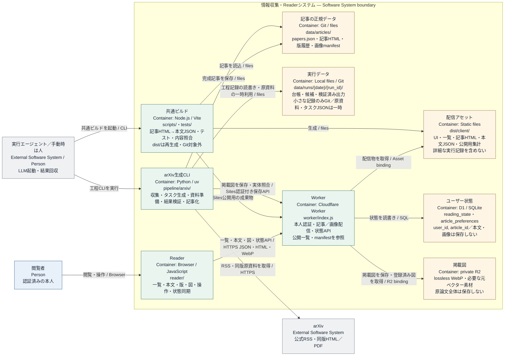

# ビルドと公開

情報源ごとの生成処理が `data/articles/` に保存した完成記事を、Reader・Workerとともにビルドして公開する。この文書はテスト、ビルド、公開、結果確認を扱う。

## 生成・保存・配信の構成

生成した記事を共通ビルドから配信する、アプリケーションと保存先の接続。



実行担当がビルド済みWorker・配信物をSitesへ公開します。Pythonは作業指示ファイルを作り、保存されたモデル結果を検証します。

ここでの「コンテナ」は実行可能なアプリ／データストアの単位で、Dockerコンテナを意味しません。

## 1. 公開の前提を確認する

[実行環境の準備](setup.md) を済ませ、公開する完成記事・版履歴と画像manifestが `data/articles/` に保存されていることを確認する。

公開先への保存・デプロイ・結果確認の機能と権限を確認する。秘密情報は実行環境の秘密情報設定へ置く。公開する記事と版、テスト・ビルド結果、公開先・識別子・デプロイ結果を、対象実行の `data/runs/<date>/<run_id>/release.json` に記録する。

## 2. テストとビルドを実行する

同じ公開先へのビルド・公開は直列化し、開始時に最新の保存済み記事を取り込む。リポジトリのルートで以下を実行する。公開予定のWorkerとmanifestを使い、画像配信の認証とパス解決もテストする。公開中のWorkerに新しい画像が登録されていることは前提にしない。テスト・ビルド・記事全体の整合性に失敗した場合は公開せず、原因を修正して再実行する。既存の記事・版履歴・図とD1のユーザー状態を保持する。

    cd /path/to/ai-platform-feedreader
    npm run typecheck
    npm test
    npm run build
    npm run test:built
    npm run test:runtime
    npm run verify

`node --test tests/sites-bridge.integration.mjs` は実PythonからHTTP模擬Sites入口・Worker・模擬R2までの図保存と読戻しを検証する。ライブのSites認証・権限・配備検証を代替するものではない。

共通ビルドはReader・記事・Workerの配信物を生成する。この時点では公開先へ反映されていない。

## 3. 公開する

公開先は実行プロンプトまたはリポジトリの設定で指定する。ChatGPT Sitesを使う場合は、次の手順で公開する。

1.  `.openai/hosting.json` のSite IDが指定された公開先と一致し、D1・R2設定がWorkerのbindingと一致していることを確認する
2.  [公開対象の固定と結果記録](#公開対象の固定と結果記録) に従って `prepare-release.mjs` で対象を固定し、返されたsnapshotを利用環境のSite管理機能で指定プロジェクトへ公開する。本人限定アクセス、蓄積した記事・版履歴とD1の状態を維持する
3.  デプロイ結果の成功・失敗を確認し、同節の `record-deployment.mjs` で公開全体の結果を保存し、対象runがあれば `release-record.mjs` で各runへ記録する。成功時は `sync-release-status.mjs` で配信中の状態を保存・読戻し確認した後、`finalize-release.mjs` を実行する。結果が不明な場合は `verification_pending` とし、先に同じ公開識別子のデプロイ状態を確認する。公開機能や権限が不足する場合はこの工程を止める

公開の完了・中断時には、`release.json` と関連する保存対象の記録をGitへコミットしてリモートへ反映する。保存できなかった場合はその状態を報告する。完成分を公開できても生成処理に残件があれば部分公開として報告し、全件完了としない。

## 公開先の設定と保護

### このリポジトリの初回設定

Sitesの利用条件・作成・配備・共有設定は、OpenAIの[利用ガイド](https://help.openai.com/en/articles/20001339-creating-and-using-chatgpt-sites)と[開発者ガイド](https://learn.chatgpt.com/docs/sites)を参照する。以下はこのリポジトリ固有の設定だけを示す。

1. 作成したSiteのIDをローカル設定へ保存する。配布版の `project_id: null` は未設定を意味する。既存の実IDを別IDで上書きしない

   ```sh
   node scripts/init-site.mjs --project-id <returned-id>
   ```

   このコマンドは `.openai/hosting.json` のIDと `DB`／`IMAGES` bindingを設定する。実記事・run記録・秘密情報・別利用者のIDは公開ソースへ含めない。
2. 本人限定（owner-private）でSites専用の入口を使い、実行環境を `TRUSTED_AUTH_HEADER=hosting`、`SITES_OWNER_PRIVATE=confirmed`、`SITES_STORAGE_ENABLED=false` にする。これらはホスト側のアクセス設定を確認した後に指定する値であり、コードが公開範囲を自動証明するものではない。外部からの同名ヘッダーを除去するSitesの認証入口以外では有効にしない
3. 本人がSiteへサインインすると、そのままReaderを開く。Sitesが本人限定アクセスを制御し、認証済みのSite固有IDを渡す。アプリはこのIDを既読・お気に入りの保存キーとして直接使用する。アプリ側の初回登録・確認ボタン・本人IDのDB登録は不要。過去の `site_owner_setup` は履歴として残すが参照しない。`OWNER_USER_ID` を明示設定した場合はそのIDとの照合を優先する。別Siteやアカウント管理APIのIDを設定しない。公開範囲を変える場合は本人IDの明示設定と認可設計を見直し、`SITES_OWNER_PRIVATE` と保存用入口を無効化してから変更する。
4. 下記の画像転送を使う場合は `SITES_STORAGE_ENABLED=true` にし、Pythonプロセスへ接続先とサービス用トークンを渡す

### PythonからSites管理R2へ保存する

Sitesは `.openai/hosting.json` の `r2: "IMAGES"` を管理・bindする。Pythonは `SitesStore()` のみを使い、Workerの `/api/storage?key=...` へHTTPSでPUT／GETする。登録前の図も保存・照合でき、読者向け `/api/images/<sha256>` は公開manifest登録済みの図だけを配信する。

- `get_site` が返す既存の `siwc_bypass_bearer_token` を使用する。Pythonの実行プロセスにだけ `READER_SITE_URL`（そのトークンの正確なSiteのHTTPS origin）、`SITES_SERVICE_TOKEN` を渡す。秘密情報をGit・ファイル・タスク文面・ログへ保存しない。トークンが返らない場合は対応する接続経路を確認し、発行・再発行を勝手に行わず必要な承認を求める
- Pythonは公式の `OAI-Sites-Authorization: Bearer ...` を送る。Sitesの入口が検証・消費するため、Workerに訪問者IDは供給されない。Pythonは本人IDを偽装するヘッダーを送らない。転送はリダイレクトを拒否し、別originへ資格情報を転送しない
- 本人限定アクセスとSites専用入口を確認した後だけ、実行環境で `SITES_STORAGE_ENABLED=true` にする。保存用の共有経路は公式Sitesのowner-privateサービスアクセス境界に依存する。ブラウザーの書込は同一originと専用ヘッダーを要求し、CORSを許可しない。ブラウザー本人IDがある場合は `OWNER_USER_ID` と照合する。service tokenで個人のD1状態へアクセスすることは許可しない
- オブジェクトキーは記事／版／SHA-256の限定形式で、最大32 MiB。PUT時と読戻し時にハッシュ・MIMEを確認する。Pythonはさらに画像を実際にデコードし、サイズ・画素のlossless性を確認する。原SVGは添付データとしてのみ転送し、Readerの画像経路から実行しない
- この共有経路を有効にしたままSiteを公開・workspace共有したり、`workers.dev`・別のプロキシ等へWorkerを公開してはいけない。公開範囲を変える場合は先に保存経路を無効化する。Worker自身はSitesの最新アクセス設定を取得・検証できない
- `READER_SITE_URL` または `SITES_SERVICE_TOKEN` が未設定なら画像保存は失敗する。Sitesを介さない直接R2接続へのフォールバックはない
- Vite設定のリソースラベルは `ai-platform-feedreader-d1`／`ai-platform-feedreader-r2`。論理bindingの `DB`／`IMAGES` は維持し、ホスト側の実リソースはSitesが管理する。これらのローカル設定名の変更で既存の実リソースを改名・新設しない

`ASSETS` は `dist/client/`、Workerは `dist/worker/`、配備metadataは `dist/.openai/hosting.json` を使う。`assets.run_worker_first: true` により全HTML・JSON・UIをWorkerの本人認証へ通す。公開asset originや公開R2で迂回させない。D1の変更はSitesが配備時に付属migrationを適用するので、手動で別DBを作成して付け替えない。

`drizzle/0000_reader_state.sql` は新規DB用の定義である。既存DBに適用する場合は実スキーマ・保存状態・適用済みSQLとjournal/snapshotを照合し、適用済み履歴を置き換えない。必要な追加変更と状態保持・復旧手順を確認してから適用する。テーブル削除、状態初期化、DBの新設・付け替えは通常の記事公開に含めない。

Readerと記事JSON/HTMLの契約は配信基盤から独立している。別の基盤では `worker/auth.js` の認証アダプター、本人限定のasset routing、D1/R2 binding、Sites固有のビルド・公開処理を対応させる。静的ファイルの公開だけでは本人限定アクセスと状態保存を提供できない。

## 公開対象の固定と結果記録

テスト・ビルド・照合を通過した後、ルートで次を実行する。

```sh
node scripts/prepare-release.mjs
```

返された `snapshot` の凍結コピーだけを公開し、`build_id` を保存する。公開ロック中は次のビルド、同じ公開先のprepare、正規記事コレクションへの追加を拒否する。生成済み記事の反映は公開結果を確定してロックを解放した後に行う。

利用環境の公開機能で得た実際の結果をJSONへ保存する。対象runが空の初回公開・UIだけの更新でも、公開全体の結果を必ず記録する。

```sh
node scripts/record-deployment.mjs "$DEPLOYMENT_RESULT_JSON"
# release-manifest.json の runs にある各runだけ、次も実行する
node scripts/release-record.mjs "$RUN_DIR" "$DEPLOYMENT_RESULT_JSON"
# succeeded の場合だけ。既存のSite service tokenをプロセス環境へ渡す
node scripts/sync-release-status.mjs "$READER_SITE_URL"
node scripts/finalize-release.mjs
```

結果JSONには `site_id`、`build_id`、`deployment_id`、`status` を含める。`status` は `verification_pending`、`succeeded`、`failed` のいずれか。成功時は `tests_passed: true`、`build_passed: true`、`verified_url`、`verified_at` も必須とする。実際の公開結果と接続確認を用い、記録JSONの作成だけを公開成功としない。

公開全体の記録は `data/releases/` に保存する。ビルド別の最新記録に加え、デプロイID別の記録を残し、後の失敗で過去の成功を消さない。凍結snapshot内の `batch-status.json` はビルド時点の値であり、公開後には書き換えない。`sync-release-status.mjs` は同じSiteの `/api/deployment-status` へ成功確認済みreceiptを保存し、読戻した内容が一致したことを確認する。receiptは既存の非公開R2の `release-status/<build_id>.json` に保存する。Readerは `/api/batch-status` から取得し、現在のビルドID・Site・記事集合に一致するreceiptだけを反映する。静的ファイルがWorkerより先に返る配信環境でも、公開結果はこのAPIを通して取得する。receiptが未保存・読取不能なら公開件数0・`verification_pending` とし、記事の配信を継続する。新しいSQL migrationや資格情報は不要。保存経路には図保存と同じ本人限定Sites境界・`SITES_STORAGE_ENABLED` を使い、書込には専用ヘッダーを要求する。トークンは記録やコマンド引数へ含めない。同期失敗時は同じビルドの同期を再実行し、成功を装ってロックを削除しない。

結果不明の間は同じ公開IDを確認し、別デプロイで上書きしない。対象runすべてへ同じ公開結果を記録した後、`node scripts/finalize-release.mjs` でロックを解放する。記録不足や `verification_pending` の間は解放しない。公開件数は確認済みの結果だけを反映する。記事追加・ビルド・公開は `data/articles/.collection.lock/` を共有する。異常終了で残った場合は `owner.json` の所有PIDと処理を確認し、記事追加・ビルド・公開が動作中でないことを確かめる。公開leaseが残っていれば先にその結果を照合する。その後に限り、停止した処理が残したロックだけを手動で削除する。競合や経過時間だけを理由に自動削除しない。

## ソースと記録の保存

保存対象を `git add` した後、`npm run check:retention` で原資料・途中画像・生成タスク・キャッシュ・秘密情報の混入を検査する。保存対象のコミットとリモート反映は権限のある作業者が行い、失敗を記録する。

検査対象はGit index内の全ファイルのパスとblobであり、作業ツリーの現在の内容ではない。stage後に作業ファイルを修正・削除しても、indexに残る秘密情報は拒否する。stage済みの削除は対象外、renameは移動先のパスとblobを検査する。未追跡・ignore対象ファイル、未stageの変更、過去のコミット履歴は検査しない。変更をstageし直したら必ず再実行する。競合中のindex、読取不能なblob、submoduleなど未対応のindex項目は検査失敗とする。

拡張子による秘密情報検査の除外はなく、`.env.example`も対象にする。既知の秘密鍵・token形式に加えて、env形式のcredential名（TOKEN、SECRET、PASSWORD、API_KEY、ACCESS_KEY、PRIVATE_KEYなど）の非空値を拒否する。テンプレートには空値、`example`、`placeholder`、`changeme`、`change_me`、`replace_me`、`your_api_key`、`your_token`、`your_secret`、`your_password`、または`<your-secret>`形式の明示的なplaceholderだけを使う。エラーには対象パスだけを出し、値は出力しない。この検査はヒューリスティックであり、すべての種類の秘密情報を検出できる保証はない。

コードを再配布する前に [第三者ライセンス](../THIRD_PARTY_NOTICES.md) を確認し、本プロジェクトの [AGPL-3.0-only](../LICENSE) の条件に従う。実論文・掲載図・私有記事・実行記録・個別の接続設定を公開ソースへ含めない。通常のテストは合成フィクスチャを使う。明示的に実行する実論文テストは、CC BY 4.0を確認したMistral 7Bの同版HTML・PDFを使い、[専用手順と出典](../pipeline/arxiv/tests/fixtures/mistral-7b-v1/README.md)に従ってGit対象外のキャッシュへ取得する。

### Exact publication-count evidence

Publication status receipts must match the exact intersection of the frozen
batch's `completed_articles` identities (`article_id`, `version`, and
`content_sha256`) with the deployed article identities. The Worker rejects
under-counts, over-counts, stale hashes, duplicate identities, and a
`completed_count` that disagrees with the identity list. It also checks this
condition before serving a stored receipt as successful publication status.

Legacy nonempty batches without `completed_articles` cannot prove a publication
count. Regenerate their batch through the adapter and rebuild before publishing
status; the status synchronizer rejects them explicitly. Legacy empty batches
(with a missing or zero `completed_count`) may publish a count of zero.
