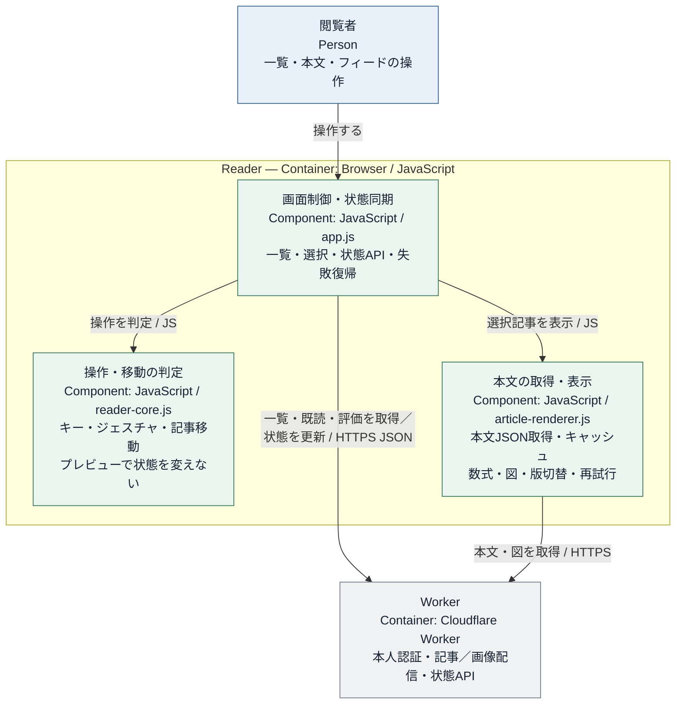

# Readerの仕様

## 一覧・本文・状態

Readerは記事一覧、選択した記事の本文と図、版履歴を表示する。情報源の切り替え、記事間の移動、既読・未読・★・badの操作を提供する。

### Readerの内部構成

一覧・本文・状態の役割と、Reader内の表示データの流れ。

## 表示データの読込み

一覧データから記事を選び、本文を必要に応じて読み込む。一覧のメタデータには情報源・記事ID・版（ある場合）・日付を表示する。記事IDは共通契約の `id` をそのまま使い、arXivに固有の形式へ変換しない。記事の識別、本文・図の参照、版履歴と状態APIは [共通の記事インターフェース](data-contracts.md) に従う。生成側から渡された見出し・本文・図の構成を保ち、一覧と独立記事から同じ内容を開けるようにする。

## 表示と操作

一覧・本文・サイドバーで次の操作を提供する。

- 情報密度の高い一覧に記事タイトル、情報源、日付、タグとコンパクトな操作を置く。選択した記事の本文と図を読みやすく表示する
- 記事は新しい順に固定する。フィード内の切り替えは「すべて・未読」の2つだけとし、★・badはサイドバーの専用一覧で扱う。並び替え操作と告知日によるフィルターは設けない。
- 既読・★・badは認証されたユーザーごとに保存し、別の端末でも同じ状態を使う。記事の更新・新版の追加・再公開で状態をリセットしない
- 一覧で選択した記事を既読にし、表示中の一覧集合を維持する。各記事は手動で既読・未読を切り替えられる。一括既読は、選択中のフィードまたはサイドバーの専用一覧で「すべて・未読」の切り替えに従う全記事を対象とする。更新の競合に対処し、失敗時は表示を戻して再試行可能にする
- デスクトップはコンパクトなインライン操作、モバイルは一覧/本文の分離、左右スワイプによる記事移動、左端操作によるサイドバー、戻る/進むとスクロール復元、安全領域対応の下部操作に対応する。プレビューやキャンセルで既読・選択を変えない
- キーボード操作はjで次の記事、kで前の記事、bで選択記事の原文を別タブに開く。sで選択記事の★を、gでbadを切り替える。Shift+j/kで次/前のフィードへ移る
- 文字入力中は記事移動などのショートカットを無効にする
- 記事移動のジェスチャは、図・表・横スクロール領域の操作と競合させない
- 本文は画像完了を待たず表示し、遅延画像・キャッシュ・通信失敗からの再試行に対応する
- 最終更新日時は日本時間（JST）で表示する
- 本文中のインライン数式 `\(...\)` と独立数式 `\[...\]` を組版して表示する。記事や版を切り替えた後も数式を表示し、独立記事とReaderで同じ内容を読めるようにする。幅の広い式は本文をはみ出さず横スクロールできるようにする

アプリ独自の検索欄は設けず、文字の検索にはブラウザ標準のページ内検索（Ctrl+F / Cmd+F）を使う。このキー操作はReaderで横取りしない。検索対象は読み込まれてページ内にあるテキストで、未読込みの記事本文を横断検索する機能ではない。

## コンテンツ更新と状態保存

記事・版履歴とユーザーの状態は分離する。記事の追加・更新・画像保存先の変更は、既読・★・badを初期化しない。

保存のキー、D1のテーブルと状態APIは [データ契約](data-contracts.md) に従う。保存失敗は操作元に表示し、再試行できるようにする。
